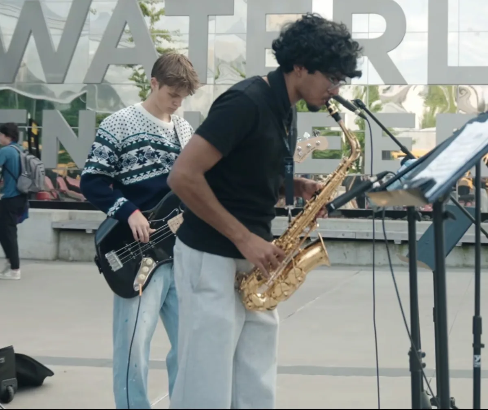
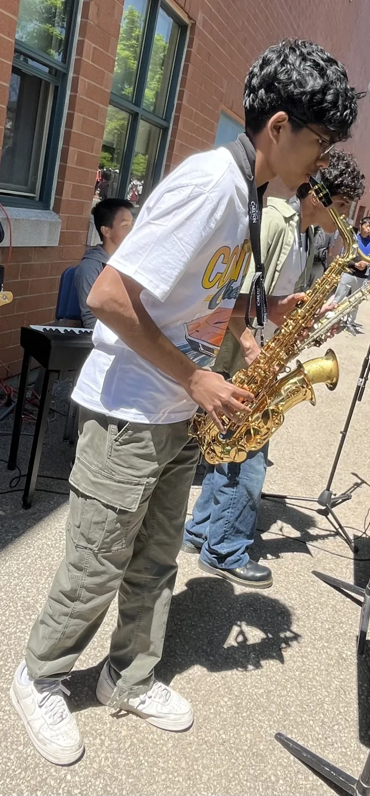
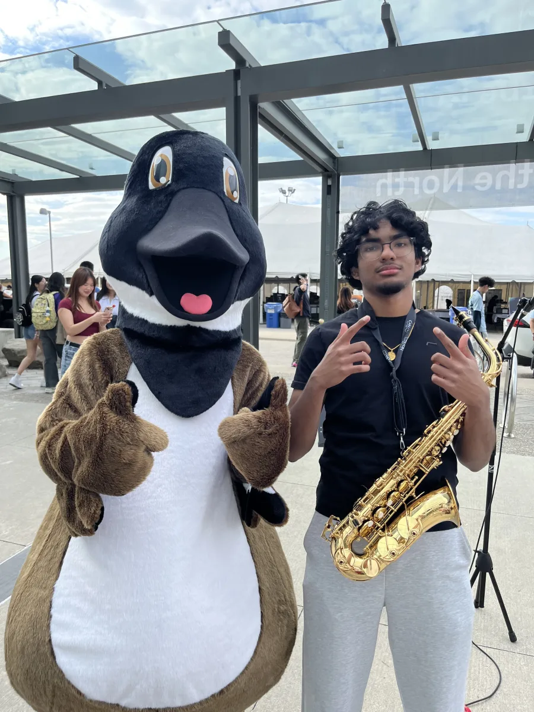

I’m interning at **Revvity**, working on healthcare AI agents.

**I’m looking for a 2027 internship** where I can learn from a small team and ship software in a fast-paced startup.

[Personal website](https://www.vishnus.online/) · [Email me](mailto:v5subram@uwaterloo.ca) · [LinkedIn](https://www.linkedin.com/in/vishnusubramani/)

## Things I’ve built

**[Dispatchient ↗](https://dispatchient.com/)** · I’m scaling Dispatchient to help property managers coordinate repairs. When a tenant texts a photo of a leak, the agent gathers details and drafts a message to the plumber. The manager can approve it or take over the conversation.

**[KeyFortly ↗](https://keyfortly.com/)** · Around **30 landlords and 2 property management businesses** pay for the property management software I built. It helps Ontario landlords track rent, manage leases, and keep up with provincial paperwork.

**[Findr ↗](https://github.com/Vishnu123vis/Findr)** · Finding a hackathon teammate is easier when you know what each person brings. We built Findr to turn résumés into skills profiles and match hackers with complementary teammates. 

**[Serverless e-commerce ↗](https://github.com/Vishnu123vis/serverless-ecommerce-platform)** · An event-driven shop I built on AWS. I used a single-table DynamoDB design and Lambda functions for workflows like sending order emails.

## After hours

  

I play alto sax. Here I am with the band at Waterloo, at an outdoor gig, and with the goose at Hack the North. Away from rehearsal, it’s usually Hollow Knight, Rocket League, or a Leafs game.
